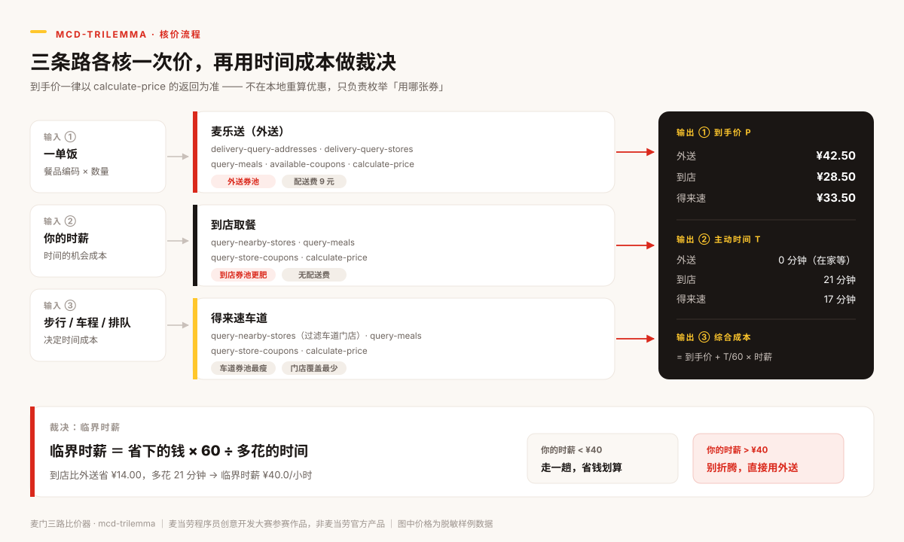

# 麦门三路比价器 · mcd-trilemma

> 同一份麦当劳，外送 / 到店取餐 / 得来速，三条路的到手价本来就不一样。
> 但这个工具真正回答的不是「哪条便宜」，而是——
> **省下的这点钱，值不值得你走这一趟。**

基于 **麦当劳中国 MCP** 的履约路线比价 Skill：把三条路各核一次价，再用「**临界时薪**」把价差折算成时间成本，
给出一个能跟你自己工资直接对话的结论，而不是一句「到店更便宜」。

麦当劳程序员创意开发大赛参赛作品 · 非麦当劳官方产品。



🎮 **在线试算（零登录，打开即玩）**：[luck2058.github.io/mcd-trilemma](https://luck2058.github.io/mcd-trilemma/)

---

## 一句话看懂

一份 **麦辣鸡腿堡 + 中薯条**（商品 ¥36.50）：

| 履约方式 | 到手价 | 你要亲自花的时间 | 用券 | 结论 |
|---|---:|---:|---|---|
| 麦乐送（外送） | **¥42.50** | 0 分钟 | 满 15 减 3 | 被收了 ¥9 配送费 |
| 到店取餐 | **¥28.50** | 21 分钟 | 到店满 30 减 8 | 最便宜 |
| 得来速车道 | ¥33.50 | 17 分钟 | 满 15 减 3 | 券池最瘦 |

到店比外送**省 ¥14.00**，但要多花 **21 分钟**：

```
临界时薪 = 14.00 × 60 ÷ 21 = ¥40.0 / 小时
```

- 你的时间值 **低于 ¥40/小时** → 走一趟，省钱划算；
- 你的时间值 **高于 ¥40/小时** → 别折腾，直接点外送。

顺带发现一个反直觉的结论：**这单加一份 ¥8 的香芋派，总价反而降 ¥1**——
因为跨过了 ¥39 免配送门槛，¥9 配送费直接消失。这不是「劝你多买」，是算清「多付多少换到什么」。

---

## 它解决什么问题

### 问题一：三条路的差价藏在三个地方，肉眼看不出来

同一份餐在三条路上的到手价差异来自三处，任何一处漏了都会算错：

1. **配送费与免配送门槛**——差 ¥2.5 够不到 ¥39，就多付 ¥9；
2. **三套完全独立的券池**——外送券到店核销不了，到店券外送也用不了；
3. **门店与菜单不同**——外送门店、到店门店、支持车道的门店是三个集合，同款餐品可能不同价、甚至有的品根本不在菜单里。

### 问题二：大模型算不准优惠券

价格、满减、折扣、封顶、免配送，叠加起来口算必错。
本项目的原则是：**取数交给 MCP，核价交给 `calculate-price`，算术交给代码，表达交给 Agent。**
本地绝不重算优惠——只负责「枚举用哪张券」然后比较官方返回的应付总价。
这样无论麦当劳的优惠规则怎么改，结论都不会失真。

### 问题三： cheapest ≠ 划算

这才是核心。「到店省 14 块」是事实，但它没告诉你这 14 块要用 21 分钟换。
**把两件事放在同一个标尺上量**，才是这个工具真正做的事。

---

## 核心概念：临界时薪

设 A 便宜但慢、B 贵但快：

```
综合成本(c) = 到手价(c) + 主动时间(c) ÷ 60 × 时薪

令 cost(A, w) = cost(B, w) 解得：

w* = (到手价(B) − 到手价(A)) × 60 ÷ (主动时间(A) − 主动时间(B))
```

`w*` 就是**临界时薪**——「你愿意为省这一笔钱付出的最高时薪」。

- `w < w*` → A 的综合成本更低 → 走 A（省钱）
- `w > w*` → B 的综合成本更低 → 用 B（省时间）
- `w = w*` → 两条路完全等价，随便选

它把一个模糊的纠结，变成了一个可以和自己工资对比的数字。

### 「主动时间」为什么要和「总时长」分开

| 概念 | 定义 | 算不算成本 |
|---|---|---|
| **主动时间** | 你必须亲自花掉的时间 | ✅ 算 |
| 总时长 | 从下单到吃上 | ❌ 不算，仅作参考 |

外送要等 30 分钟，但那 30 分钟你在写代码、开会、追剧——时间是并行的。
到店往返 16 分钟不能并行，那 16 分钟被这段路独占了。

> 反例也要说清楚：如果你本来就想下楼透口气，这 16 分钟的「成本」其实是负的，
> 那这套账就不适用——它算的是时间成本，不是心情。

### 帕累托前沿：哪些选项可以直接划掉

在 `(到手价, 主动时间)` 双目标下，被其他路线「既更便宜又更省时间」支配的选项，
**无论你的时薪是多少都不可能是最优解**——可以直接从选项里删掉，不用再纠结。

---

## 快速开始

零依赖，只需要 Python 3.8+，不需要 `pip install` 任何东西。

```bash
git clone https://github.com/Luck2058/mcd-trilemma.git
cd mcd-trilemma/skills/mcd-trilemma/scripts
```

### 1. 离线跑一遍（不需要 Token）

```bash
python trilemma.py --offline
```

用 `sample_data/` 里的脱敏样例数据演示完整链路，输出可直接内嵌到对话里的 Markdown 表格。

### 2. 调参数，看结论怎么翻

```bash
# 时薪 15 元：结论变成「走到店划算」
python trilemma.py --offline --wage 15

# 时薪 80 元、步行只要 3 分钟
python trilemma.py --offline --wage 80 --walk 3

# 只要结构化结果
python trilemma.py --offline --json
```

### 3. 接真实 MCP 核价

先去 [open.mcd.cn/mcp](https://open.mcd.cn/mcp) 申请 Token，然后：

```bash
export MCD_MCP_TOKEN=你的Token        # Windows: set MCD_MCP_TOKEN=你的Token

# 先查门店真实菜单，拿到可用的 productCode
python trilemma.py --search 麦辣鸡腿 --city 成都

# 三路实时核价（city 不带「市」）
python trilemma.py --live --city 成都 --request sample_data/request_live.json
```

> **外送链路需要账号下已存收货地址**。没有地址时外送会如实标记为不可用，
> 不会伪造地址或估算价格——先在外卖 App 里存一个地址再跑。

#### 实测记录

成都某门店、一份「麦辣鸡腿汉堡 + 薯条」，真实接口返回：

```
麦乐送（外送）  ❌ 账号下没有外送收货地址，外送链路不可用
到店取餐        ¥36.00   7 分钟（按门店距离 21 米自动推算）
得来速车道      ¥36.50   21 分钟（车道门店在 4.7 公里外）
本次核价共发起 9 次 MCP tools/call
```

外送链路之所以不可用，是因为该账号还没存过收货地址——**这正是三级降级该有的样子**：
能用几路算几路，缺哪路说明原因，不编数据。

### 4. 对接校验（字段名变了的时候用它）

```bash
python trilemma.py --probe
```

打印 `tools/list` 与关键工具的**原始返回**，方便按真实 schema 调整字段映射。

### 5. 自测

```bash
python selftest.py
# 30/30 通过
```

### 在 WorkBuddy 里当 Skill 用

把 `skills/mcd-trilemma/` 整个目录放进你的 Skill 目录，然后直接问：

> 我想吃麦辣鸡腿堡加中薯条，我是点外卖还是下楼买？我时薪大概 45。

---

## 实际输出

```markdown
### 三路到手价对比

| 履约方式 | 到手价 | 你要花的时间 | 综合成本 | 用券 | 省下 |
|---|---:|---:|---:|---|---:|
| 麦乐送（外送） ⭐ | ¥42.50 | 0 分钟 | ¥42.50 | 全渠道满 15 减 3 | ¥3.00 |
| 到店取餐 | ¥28.50 | 21 分钟 | ¥44.25 | 到店满 30 减 8 | ¥8.00 |
| 得来速车道 | ¥33.50 | 17 分钟 | ¥46.25 | 全渠道满 15 减 3 | ¥3.00 |

### 临界时薪：这趟值不值得走

- **到店取餐** 比 麦乐送（外送） 省 ¥14.00，但多花 21 分钟 → 临界时薪 ¥40.0/小时。
  你的时薪 ¥45，结论：别折腾，直接用 **麦乐送（外送）**。
- **到店取餐** 比 得来速车道 省 ¥5.00，但多花 4 分钟 → 临界时薪 ¥75.0/小时。
  你的时薪 ¥45，结论：走 **到店取餐** 划算。

### 凑单提示

你的外送单还差 ¥2.50 到免配送门槛（当前被收 ¥9 配送费）。
再加一份 香芋派（原价 ¥8.00）后，到手价 ¥42.50 → ¥41.50，
加购后到手价反而更低，净省 ¥1.00，直接凑。
```

---

## 目录结构

```
mcd-trilemma/
├── README.md                     你正在看的这份
├── CONTEST_DECLARATION.md        参赛声明（官方原文，未改动）
├── MCP_INTEGRATION.md            MCP 调用链路与业务价值说明
├── mcp-config.example.json       脱敏 MCP 配置（仅环境变量占位符）
├── workbuddy.md                  WorkBuddy 开发对话上下文
├── docs/index.html               在线试算页（纯前端，算法完整移植）
├── images/how-it-works.svg       核价流程图
└── skills/mcd-trilemma/
    ├── SKILL.md                  Skill 主文件：触发条件与执行流程
    ├── references/
    │   ├── mcp-tools.md          每个工具的入参、返回与踩坑点
    │   └── pricing-model.md      到手价公式、时间模型、临界时薪推导
    └── scripts/
        ├── mcp_client.py         零依赖 MCP Streamable HTTP 客户端
        ├── trilemma.py           核价引擎 + 命令行
        ├── selftest.py           30 项离线自测
        └── sample_data/          脱敏样例数据
```

---

## 目标用户

| 用户 | 场景 | 他真正纠结的事 |
|---|---|---|
| **写字楼上班族** | 午休 40 分钟，楼下 300 米有店 | 下去吃还是点外卖？排队会不会来不及 |
| **学生 / 宿舍党** | 预算紧，时间松 | 走 15 分钟省 14 块，值不值 |
| **有车一族** | 通勤路上顺路取餐 | 绕进得来速多花 5 分钟，比到店便宜吗 |
| **对价格敏感的精算型用户** | 手里握着一堆券 | 这些券到底哪张在这条路上能用 |

共同点：**不是不知道价格，而是不知道时间值多少。** 本工具补的就是这一块。

---

## 设计取舍

**为什么不用大模型直接算钱？**
因为会算错。满减门槛、折扣封顶、免配送只抵运费不抵商品——每一条都是坑。
`selftest.py` 里有一条断言专门锁死「免配送券不能既免运费又扣商品金额」，
这个错误极隐蔽：它让结果看起来更划算，用户不会质疑，但决策就错了。

**为什么不自动下单？**
`create-order` 在能力范围内，但默认不调。比价是帮用户看清楚，下单是替用户花钱——
中间必须留一次明确确认。工具的作用是让人更清醒，不是让人更冲动。

**为什么只有三条路？**
因为刚好构成一个 trilemma：**便宜、省时、少走路，三者只能挑两个。**
再加路线不会让决策更清楚，只会让输出更长。

**为什么不自动领券？**
`auto-bind-coupons` 能一键领完麦麦省。但那是替用户做消费决策，不是比价该干的事。

---

## 已知边界（诚实说明）

1. **样例数据是脱敏近似值**，价格与券面不代表麦当劳官方报价。真实结论必须走 `--live`。
2. **外送 ETA 与门店距离依赖 MCP 返回**，若接口未返回，用请求参数里的默认值（步行 8 分钟 / 车程 6 分钟 / 排队 5 分钟），此时时间成本是用户估计而非实测。
3. **得来速需要你有车**。没有车就别选这条路——工具不会替你判断你有没有车。
4. **时薪这个参数是主观的**。对没有工资的学生，它更接近「这一小时本来能干什么」的估价。默认 ¥45 只是个起点，**结论随时薪翻转正是本工具想让你看见的事**。
5. **不构成营养或医疗建议**，也不处理口味、忌口、过敏（那是另一个问题域）。

---

## 关于本活动

本项目参加 [麦当劳程序员创意开发大赛](https://github.com/M-China/mcd-developer-innovation-challenge)，
使用腾讯 WorkBuddy 完成需求梳理、Skill 设计与代码实现，开发过程记录见 [`workbuddy.md`](workbuddy.md)。

- 参赛声明：[`CONTEST_DECLARATION.md`](CONTEST_DECLARATION.md)
- MCP 调用说明：[`MCP_INTEGRATION.md`](MCP_INTEGRATION.md)
- 麦当劳 MCP Server 文档：[M-China/mcd-mcp-server](https://github.com/M-China/mcd-mcp-server)

## License

MIT · 见 [LICENSE](LICENSE)

麦当劳、McDonald's、巨无霸、麦乐送等名称与标识归其各自权利人所有，本项目不构成任何商标授权。
项目输出仅供参考，餐品信息、价格及供应状态以麦当劳官方渠道的实时结果为准。
